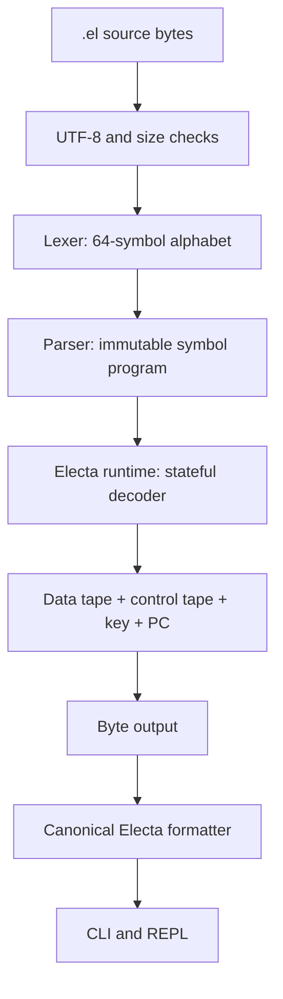
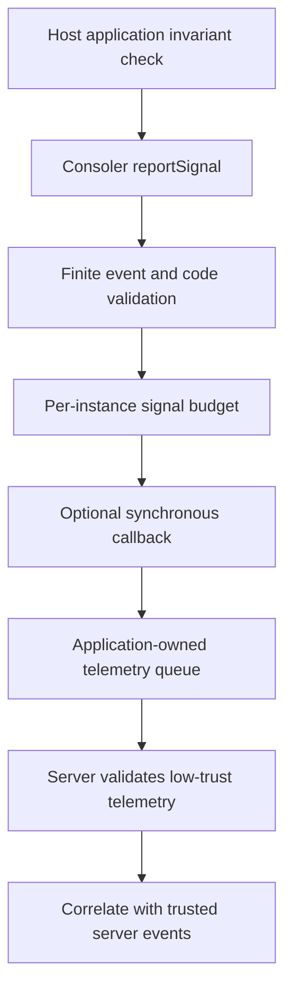

# Neutron Architecture

## Repository overview

## Electa execution path

1. The CLI reads a bounded regular source file or accepts a line in the REPL.
2. The lexer checks source length, permitted whitespace, alphabet membership, and source positions.
3. The parser creates an immutable source-symbol representation. It does not pre-decode opcodes because decoding depends on runtime state.
4. The runtime decodes and executes one instruction at a time, updates the key, and enforces fuel.
5. The formatter converts emitted bytes and execution status into canonical Electa notation.

## Consoler path

Consoler does not detect DevTools, perform network requests, or make authorization decisions. The application and server own telemetry delivery and security policy.
